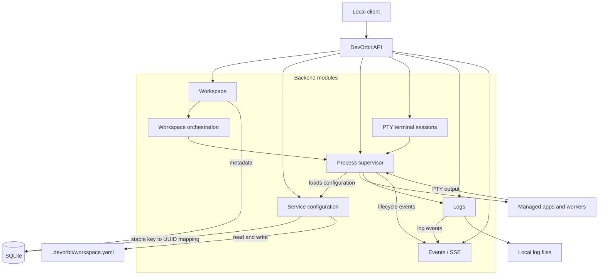

# DevOrbit architecture

Service configuration lives only in each workspace's `.devorbit/workspace.yaml`. SQLite holds workspace metadata and service identities for stable UUID and log associations. The API validates YAML before saving it atomically, and each start loads a fresh validated snapshot. Process state and live events stay in memory; logs are stored in local files. A worker is a managed service, not a separate DevOrbit module.

Each service execution owns a PTY session. The Go API exposes its raw output, input, and resize through an authenticated WebSocket scoped to the service and execution ID. Tauri keeps the bearer token in Rust and forwards output to xterm.js through a channel. The supervisor drains output even without a viewer and retains 1 MiB for reconnect replay. New log entries use the merged, readable `terminal` stream; older `stdout` and `stderr` entries remain available.
