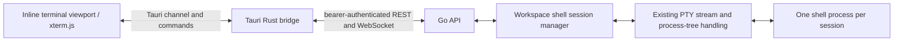

# Interactive terminal manager plan

## Current state and goal

DevOrbit renders terminal output with xterm.js. On Unix, a configured service runs inside a private tmux session named after the service, and the backend attaches its PTY to that session. The session remains interactive after the service command exits because tmux opens a shell in the same pane.

Add workspace-scoped **shell terminals** for normal command-line work. A user can create several independent shells in a workspace, switch between them, type and paste, resize, search, and close them. Service terminals stay attached to service lifecycles and remain available in the same workspace view.

## Product behavior

- In one inline **Terminal** workspace view, show one active xterm viewport and a compact strip for configured service sessions and independent shells. Starting services opens this view automatically. Switching sessions reattaches the existing stream and does not launch another PTY or service. Label shells distinctly so Close cannot be mistaken for service Stop.
- New Terminal starts the platform's default shell in the selected workspace root: `$SHELL` with `/bin/sh` fallback on Unix, or `%COMSPEC%` with `cmd.exe` fallback on Windows. It receives the user's inherited environment plus terminal settings such as `TERM=xterm-256color` where applicable. Use an executable and argument array; never interpolate a shell command. If the workspace directory or shell is unavailable, show a clear creation error without making a tab.
- The strip shows a short label and running/exited state. A shell remains alive when the user leaves the Terminal view, switches workspaces, or the desktop view unmounts. Returning to the workspace lists and reattaches its sessions. Closing a shell explicitly terminates its process tree and removes the session; if a shell exits itself, leave its final screen visible until Close.
- The active viewport receives keyboard input. Keep xterm's copy, paste, selection, search, and bounded scrollback. Fit and send PTY dimensions when the viewport attaches or changes size. Show reconnecting, disconnected, exited, and output-gap states. tmux prefix keys and compact split controls create panes inside a service session.
- Do not persist shell input or output in service logs. Sessions and recent output live in Go memory and end on backend shutdown; the UI should say so if it reconnects after a restart. Workspace root changes affect new shells only. Reject workspace deletion while it owns shell sessions, or require the user to close them first.

## Ownership and data flow

The Go backend owns shell processes, so detaching the desktop does not kill them. Each terminal gets an opaque session ID and a workspace ID. Use a separate instance of the existing process supervisor without service log capture or service events, wrapped by a small manager that tracks workspace ownership and session metadata. This reuses PTY streaming and process-tree shutdown without mixing shells into service status. Add a safe way to forget a closed session so its replay buffer is released. A fixed session limit prevents unbounded process creation; start with 16 shells per workspace.

## API contract

| Route | Purpose |
| --- | --- |
| `GET /api/v1/workspaces/{workspace}/terminals` | List that workspace's live and exited sessions with ID, shell label, state, start time, and exit code. |
| `POST /api/v1/workspaces/{workspace}/terminals` | Start one shell in the workspace root and return its session metadata. No arbitrary command, cwd, or environment in the first version. |
| `DELETE /api/v1/workspaces/{workspace}/terminals/{terminal}` | Stop the process tree if running and remove the session. Idempotent for an already exited session. |
| `GET /api/v1/workspaces/{workspace}/terminals/{terminal}/stream?after={sequence}` | Authenticated WebSocket for output, input, resize, and detach, using the existing terminal frame format. |

Check workspace existence and session ownership on every route and input/resize operation. Coordinate session creation and workspace deletion under the manager's workspace lock so a concurrent request cannot leave an orphan session. Keep the current bearer-token, loopback Host, Origin, frame-size, input-size, resize, and replay limits. A WebSocket close detaches a viewer; only DELETE or backend shutdown stops a shell. Preserve sequence numbers and the explicit `gap` frame when old output has been evicted. Do not expose the bearer token or a generic HTTP or shell command to the WebView. The existing local API token already permits service command execution; shell endpoints carry the same authority and must remain on loopback.

## Build order and touchpoints

1. **Session lifecycle in Go.** Add a workspace shell manager that starts a platform-default shell through a separate instance of the existing supervisor, lists sessions, attaches to their streams, stops and removes them, and closes all sessions during backend shutdown. Add the small safe-forget operation needed after shell Close. Ensure a reader drains output with no viewer. Keep exited sessions' replay until Close. Handle a missing workspace root and shell launch failure without leaking environment values.
2. **HTTP and workspace integration.** Add a small terminal controller/routes module, wire it into `internal/routes` and `internal/app`, and check workspace existence through the existing workspace service. Update workspace deletion to report a conflict when shell sessions remain. Document endpoints and the fact that sessions are temporary.
3. **Tauri bridge.** Extend `desktop/src-tauri/src/main.rs`'s route allowlist for the exact new REST routes. Reuse `terminal.rs`'s authenticated WebSocket and channel loop for shell targets; key connections by session/viewer ID so tabs do not replace one another or disconnect a newer viewer. Keep reconnect replay and stop reconnecting when a session has exited or been deleted.
4. **Desktop UI.** Add session types and API methods in `desktop/src/api.ts`. Render a single inline xterm viewport and compact service/shell switcher in `App.tsx`. Reuse `TerminalPane.tsx` for the active service or shell, and update `styles.css` so the viewport fills the content area. Re-list sessions after backend reconnect; on a replay gap, show a visible marker. Keep the shell's final screen and exit code until the user closes its session.
5. **Verify.** Go tests: multiple independent shells, workspace cwd, input/resize/replay, exited replay, close/process-tree cleanup, wrong-workspace and stale IDs, session limit, and backend shutdown. API tests: auth, ownership, invalid frames, and deletion conflict. Rust test: only the intended routes pass the allowlist. UI tests: create/switch/close sessions, large paste chunking, resize, reattach, and connection states. Check service stop after a tmux split. Manually check a full-screen program and shell prompt on Linux, macOS, and Windows where those platforms are available.

## First-version boundary

Show all sessions in one compact strip and one spacious terminal viewport. Selectable shell profiles, persistent sessions across backend restarts, and command history syncing can follow later. Service sessions use tmux on Unix; Windows retains the direct PTY behavior.
