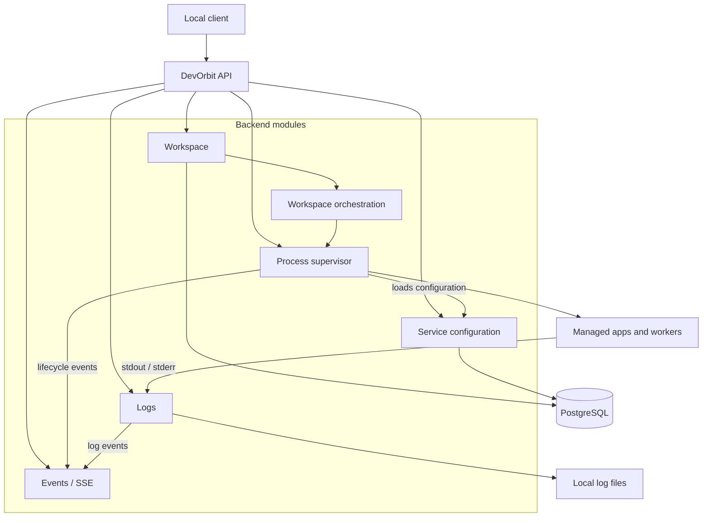

# DevOrbit architecture

Workspace and service configurations live in PostgreSQL. Process state and live events stay in memory; logs are stored in local files. A worker is a managed service, not a separate DevOrbit module.
